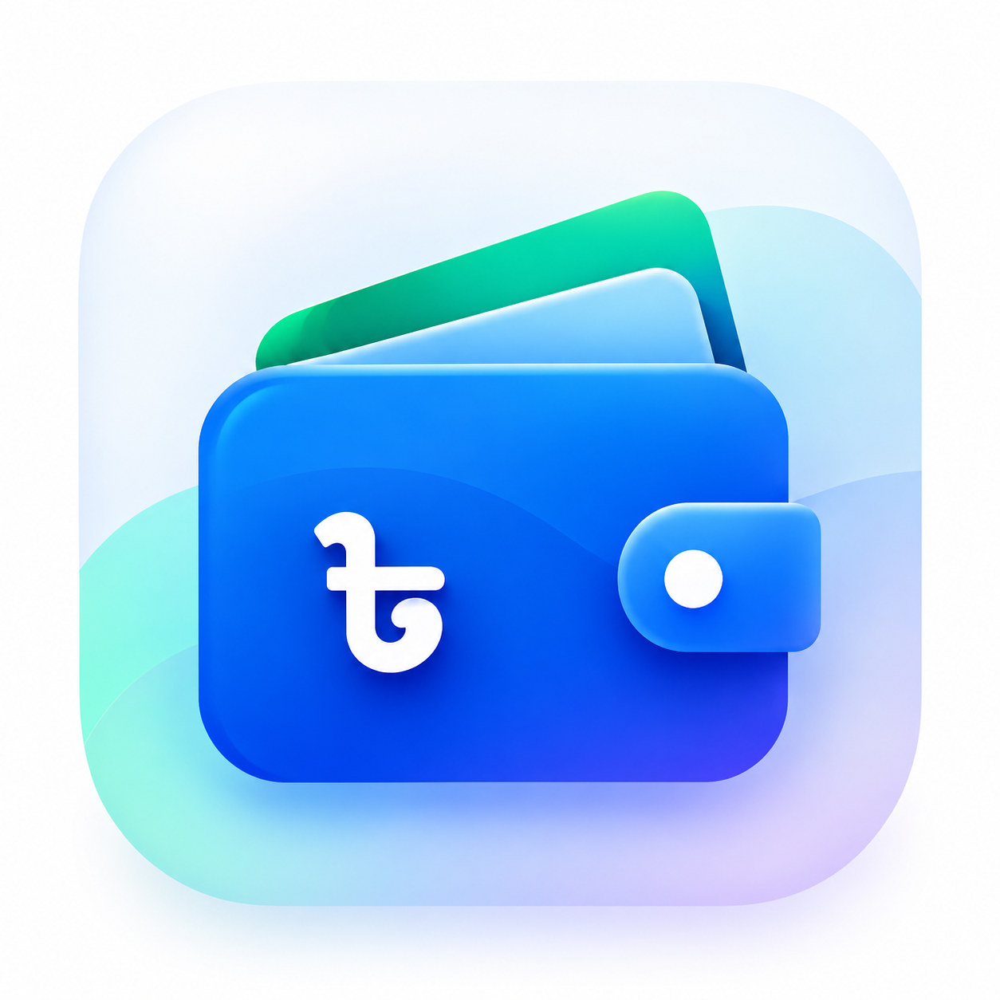

  
  <h1>Hishab Pati (হিসাব পাতি)</h1>
  
<strong>Your Money, Your Control.</strong>

  
A modern, offline-first personal finance & expense tracker built natively for Android with Jetpack Compose—tailored for Bangladesh and beyond.

  

    
    
    
    
  

---

## ✨ Overview

**Hishab Pati** is a privacy-focused, offline-first personal finance management app designed to organize daily transactions, monitor spending, and manage accounts, budgets, savings goals, and debts in one place. Built natively with **Kotlin** and **Jetpack Compose**, it pairs a calm frosted-glass interface with localized banking directories—including **61 local banks** and **13 Mobile Financial Services (MFS)** providers—while keeping your financial records stored privately on your device with optional Google Cloud sync.

---

## 🌟 What Makes Hishab Pati Unique?

* 🇧🇩 **Built-in Bangladesh Financial Ecosystem:** Pre-loaded directory of **61 Local Banks** and **13 MFS Providers** (*bKash, Nagad, Rocket, Upay, MYCash, Islami Bank mCash, TAP,* and more) complete with authentic brand badges and virtual card previews.
* 🌐 **Full Bilingual Experience (English & বাংলা):** Switch seamlessly between **English** and **বাংলা (Bangla)** directly inside the app.
* 🔒 **Offline-First & Private by Default:** Powered by local Room storage so the app works 100% offline with zero mandatory sign-up—plus optional **Google Sign-In & Firebase Cloud Sync** for multi-device backup.
* 🎙️ **3-in-1 Smart Transaction Entry:** Log transactions effortlessly using the **built-in Calculator Keypad**, **Voice-to-Transaction input**, or **Receipt OCR camera scanning**.
* 🧰 **All-in-One Financial Toolkit:** Dedicated built-in utilities for **Currency Conversion**, **Net Worth tracking**, **Monthly Recaps**, **Spending Comparisons**, **Income Tracking**, and a **Financial Calendar**.
* 🔄 **Direct GitHub In-App Updates:** Check for and install the latest APK releases straight from GitHub without leaving the app.

---

## 🚀 Key Features

### 💳 Multi-Wallet & Card Management
* **4 Account Types:** Manage **Debit Cards**, **Credit Cards** (with outstanding balance & billing cycle tracking), **Cash**, and **MFS Wallets** in one unified view.
* **Interactive Virtual Card Previews:** Real-time card styling with custom color themes (*Sapphire Blue*, midnight slate, emerald, crimson, and more), card network badges (*Visa, Mastercard, American Express, UnionPay*), account subtypes (*Salary, Savings, Current*), and last-4-digit identifiers.
* **Smart Balance Inclusion:** Toggle *"Include in Total Balance"* per wallet to separate savings accounts or credit limits from everyday spending money.

### ⚡ Fast & Frictionless Transaction Logging
* **Expense, Income & Transfers:** Dedicated tabs for logging expenses, recording income, and transferring funds between accounts without distorting spending analytics.
* **Built-In Calculator Keypad:** Calculate split bills or multiple items directly inside the amount input (with an optional auto-open keypad toggle).
* **Voice & Receipt OCR:** Speak a transaction naturally or snap a photo of a receipt to auto-extract amounts and merchant details.
* **Categories & Subcategories:** Clean spending categories (such as *Daily Essentials*) with toggleable subcategory granularity.
* **Searchable Activity Feed:** Instantly search transactions by keyword, sort chronologically or by amount, and apply multi-criteria filters.

### 🎯 Planning, Budgets, Goals & Debts
* **Savings Goals:** Create targeted savings goals with automated monthly contribution breakdowns (*"Save for something that matters"*).
* **Loans & Debt Ledger (Dena-Paona):** Track money lent and borrowed with active balance tracking and repayment logs.
* **Monthly Budgets:** Configure monthly spending limits with real-time progress tracking and budget dashboards.
* **Built-In Financial Tools:**
  * **Converter:** Instant currency conversion (`BDT ৳` ↔ `USD $` and global currencies)
  * **Net Worth:** Unified asset-minus-liability tracking across all accounts
  * **Monthly Recap:** Month-end financial summary and highlights
  * **Spending Comparison:** Compare spending patterns across time periods
  * **Income Tracker:** Dedicated view for tracking income streams
  * **Calendar:** Day-by-day visual timeline of transactions and upcoming schedules

### 📊 Financial Insights & Analytics
* **Flexible Time Periods:** Analyze finances across **Daily**, **This Week**, **This Month**, **Last Month**, or custom date ranges.
* **Interactive Charts & Breakdowns:** Track **Spending Trends** (daily average & peak spending), **Ranked Category Breakdowns**, and **Income vs. Expense Cash Flow Comparisons**.
* **One-Tap Report Export:** Export filtered financial reports directly from the Insights dashboard.

### 🛡️ Backup, Security & Customization
* **Local & Cloud Backups:** Export and restore full **JSON** or **CSV** files locally, save or share sample templates, or schedule **Daily / Weekly automatic cloud backups** with multi-device sync.
* **Device Screen Lock:** Require your device's biometric or PIN screen lock to open the app.
* **Customizable Home & Themes:** Reorder or toggle sections on your Home dashboard, switch themes (*Sky Cyan*, light/dark modes), set your preferred start of week, and toggle tactile haptic feedback.

---

## 🎨 Design Language

Hishab Pati is built around a calm, modern **Frosted Glass & Soft Pastel Gradient** design system:
* **Airy Pastel Canvas:** Gentle sky-cyan to soft-lavender ambient gradients paired with elevated, rounded white cards (`24.dp` corners) for clear visual hierarchy.
* **Floating Frosted Navigation:** A translucent pill-shaped bottom navigation bar (*Home, Activity, Plan, Insights*) paired with a floating `+` quick-action button.
* **Tactile Micro-Interactions:** Smooth transitions, live interactive card previews, and subtle haptic feedback across interactions.

---

## 📥 Installation

1. Go to the [**Releases**](https://github.com/khanistiak/Hishab-Pati/releases/latest) page.
2. Download the latest **`HishabPati-vX.X.X.apk`** file under **Assets**.
3. Open the APK on your Android device (allow *"Install from unknown sources"* if prompted).
4. Start tracking offline immediately—or sign in with Google to enable cloud backup and sync.

---

## 🛠️ Tech Stack & Architecture

* **Language:** Kotlin
* **UI Framework:** Jetpack Compose (Material 3 + Custom Frosted Glass components)
* **Architecture:** MVVM + Repository Pattern (`StateFlow` & Kotlin Coroutines)
* **Local Persistence:** Room Database + DataStore Preferences
* **Cloud & Authentication:** Firebase Authentication (Google Sign-In) & Cloud Firestore
* **Smart Input:** Google ML Kit (Receipt OCR) & Android SpeechRecognizer (Voice Entry)
* **Background Processing:** Android WorkManager (Scheduled Auto-Backups & Reminders)
* **Testing:** JUnit, Robolectric & Firebase Emulator Suite

---

## 👨‍💻 Developer

Developed with ❤️ in Bangladesh by **Khan Istiak Shahabuddin**

* GitHub: [@khanistiak](https://github.com/khanistiak)
